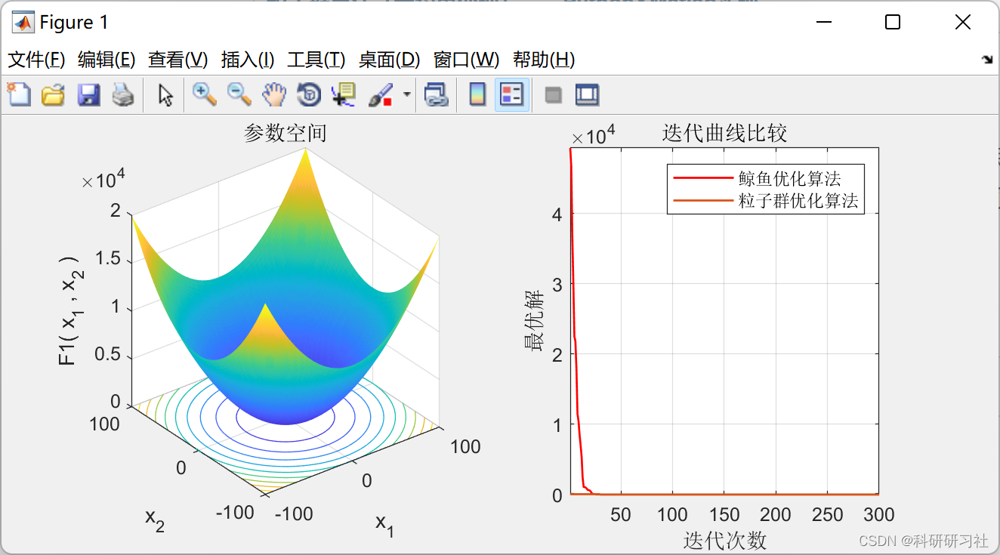
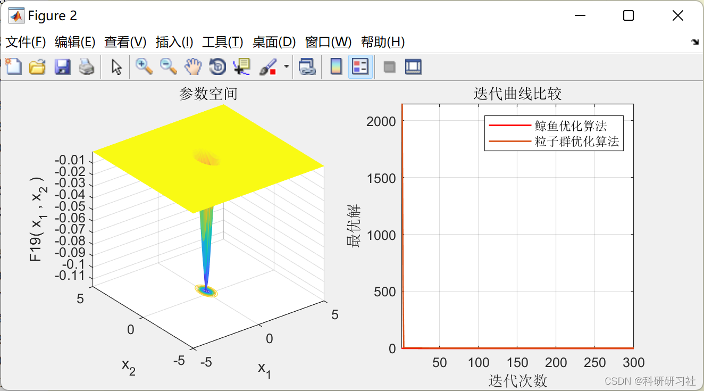

# Comparison of Particle Swarm Optimization and Whale Optimization (Matlab Code)

​  
1. Particle Swarm Optimization Algorithm (PSO: Particle Swarm Optimization) is an evolutionary computation technique. It originated from the study of bird flocking behaviors. The basic idea of Particle Swarm Optimization Algorithm is to find the optimal solution through collaboration and information sharing among individuals in a group.
PSO's advantages: it is simple and easy to implement, with no need for many parameter tuning. It has been widely used in function optimization, neural network training, fuzzy system control, and other areas of genetic algorithm applications.
The concept of the Particle Swarm Optimization (PSO) algorithm originates from the real-life process of birds hunting. Imagine a scenario in which there are m birds in an n-dimensional space, each hunting for food that is located at some point in the n-dimensional space. At any given moment, for each of the i-th bird, there are two vectors describing its position and velocity. The "goodness" of a position is determined by how close it is to the food source, or whether it is closer or farther away. During the hunt, the bird adjusts its velocity based on its own experience and the positions of other birds in the flock. By using its current position and velocity, it can predict where it will be at the next moment. This allows each bird to continually update its position and velocity through learning from both itself and the flock, ultimately finding the food or approaching it sufficiently close.
Particle swarm optimization is a classic adaptive algorithm. It is similar to algorithms such as bat algorithm, cuckoo search algorithm, and honeybee algorithm. The movement of a particle will reference both the historical best and the current best. By setting c1 and c2 to represent the importance of these two factors, each particle's speed of movement varies. The speed of movement is also influenced by w. Together, these three elements determine the next position that the particle will reach.
This article provides a detailed summary:
Particle Swarm Optimization (with Constraint Handling) - Python & Matlab implementation
2. Whale Optimization Algorithm (WOA)
The Whale Optimization Algorithm (WOA) was proposed by Australian scholars Mirjaili et al. in 2016, as a population-based optimization algorithm inspired by the hunting behavior of humpback whales. Each whale is considered a particle, with each particle representing a different decision variable. The implementation process of WOA mainly includes three stages: encircling the prey, spiral hunting, and random search.
My article provides a detailed summary:
Whale Optimization Algorithm (Matlab Implementation)
3. Comparison between Particle Swarm Optimization and Whale Optimization
Here are two function spaces for comparison:
Edit
Edit
\n%% All spaces\n\nfunction [lb,ub,dim,fobj] = Get_Functions_details(F)\n\n\nswitch F\n    case 'F1'\n        fobj = @F1; \n        lb=-100; \n        ub=100; \n        dim=30; \n        \n    case 'F2'\n        fobj = @F2; \n        lb=-10; \n        ub=10; \n        dim=30; \n        \n    case 'F3'\n        fobj = @F3; \n        lb=-100; \n        ub=100; \n        dim=30; \n        \n    case 'F4'\n        fobj = @F4; \n        lb=-100; \n        ub=100; \n        dim=30; \n        \n    case 'F5'\n        fobj = @F5; \n        lb=-30; \n        ub=30; \n        dim=30; \n        \n    case 'F6'\n        fobj = @F6; \n        lb=-100; \n        ub=100; \n        dim=30; \n        \n    case 'F7'\n        fobj = @F7; \n        lb=-1.28; \n        ub=1.28; \n        dim=30; \n        \n    case 'F8'\n        fobj = @F8; \n        lb=-500; \n        ub=500; \n        dim=30; \n        \n    case 'F9'\n        fobj = @F9; \n        lb=-5.12; \n        ub=5.12; \n        dim=30; \n        \n    case 'F10'\n        fobj = @F10; \n        lb=-32; \n        ub=32; \n        dim=30; \n        \n    case 'F11'\n        fobj = @F11; \n        lb=-600; \n        ub=600; \n        dim=30; \n        \n    case 'F12'\n        fobj = @F12; \n        lb=-50; \n        ub=50; \n        dim=30; \n        \n    case 'F13'\n        fobj = @F13; \n        lb=-50; \n        ub=50; \n        dim=30; \n        \n    case 'F14'\n        fobj = @F14; \n        lb=-65.536; \n        ub=65.536; \n        dim=2; \n        \n    case 'F15'\n        fobj = @F15; \n        lb=-5; \n        ub=5; \n        dim=4; \n        \n    case 'F16'\n        fobj = @F16; \n        lb=-5; \n        ub=5; \n        dim=2; \n        \n    case 'F17'\n        fobj = @F17; \n        lb=[-5,0]; \n        ub=[10,15]; \n        dim=2; \n        \n    case 'F18'\n        fobj = @F18; \n        lb=-2; \n        ub=2; \n        dim=2; \n        \n    case 'F19'\n        fobj = @F19; \n        lb=0; \n        ub=1; \n        dim=3; \n        \n    case 'F20'\n        fobj = @F20; \n        lb=0; \n        ub=1; \n        dim=6; \n        \n    case 'F21'\n        fobj = @F21; \n        lb=0; \n        ub=10; \n        dim=4; \n        \n    case 'F22'\n        fobj = @F22; \n        lb=0; \n        ub=10; \n        dim=4; \n        \n    case 'F23'\n        fobj = @F23; \n        lb=0; \n        ub=10; \n        dim=4; \nend\n\nend\n\n% F1\n\nfunction o = F1(x)\no=sum(x.^2); \nend\n\n% F2\n\nfunction o = F2(x)\no=sum(abs(x))+prod(abs(x)); \nend\n\n% F3\n\nfunction o = F3(x)\ndim=size(x,2); \no=0; \nfor i=1:dim\n    o=o+sum(x(1:i))^2; \nend\nend\n\n% F4\n\nfunction o = F4(x)\no=max(abs(x)); \nend\n\n% F5\n\nfunction o = F5(x)\ndim=size(x,2); \no=sum(100*(x(2:dim)-(x(1:dim-1).^2)).^2+(x(1:dim-1)-1).^2); \nend\n\n% F6\n\nfunction o = F6(x)\no=sum(abs((x+.5)).^2); \nend\n\n% F7\n\nfunction o = F7(x)\ndim=size(x,2); \no=sum([1:dim].*(x.^4))+rand; \nend\n\n% F8\n\nfunction o = F8(x)\no=sum(-x.*sin(sqrt(abs(x)))); \nend\n\n% F9\n\nfunction o = F9(x)\ndim=size(x,2); \no=sum(x.^2-10*cos(2*pi.*x))+10*dim; \nend\n\n% F10\n\nfunction o = F10(x)\ndim=size(x,2); \no=-20*exp(-.2*sqrt(sum(x.^2)/dim))-exp(sum(cos(2*pi.*x))/dim)+20+exp(1); \nend\n\n% F11\n\nfunction o = F11(x)\ndim=size(x,2); \no=sum(x.^2)/4000-prod(cos(x./sqrt([1:dim])))+1; \nend\n\n% F12\n\nfunction o = F12(x)\ndim=size(x,2); \no=(pi/dim)*(10*((sin(pi*(1+(x(1)+1)/4)))^2)+sum((((x(1:dim-1)+1)./4).^2).*...\n(1+10.*((sin(pi.*(1+(x(2:dim)+1)./4)))).^2))+((x(dim)+1)/4)^2)+sum(Ufun(x,10,100,4)); \nend\n\n% F13\n\nfunction o = F13(x)\ndim=size(x,2); \no=.1*((sin(3*pi*x(1)))^2+sum((x(1:dim-1)-1).^2.*(1+(sin(3.*pi.*x(2:dim))).^2))+...\n((x(dim)-1)^2)*(1+(sin(2*pi*x(dim)))^2))+sum(Ufun(x,5,100,4)); \nend\n\n% F14\n\nfunction o = F14(x)\naS=[-32 -16 0 16 32 -32 -16 0 16 32 -32 -16 0 16 32 -32 -16 0 16 32 -32 -16 0 16 32; ,...\n-32 -32 -32 -32 -32 -16 -16 -16 -16 -16 0 0 0 0 0 16 16 16 16 16 32 32 32 32 32]; \n\nfor j=1:25\n    bS(j)=sum((x'-aS(:,j)).^6); \nend\no=(1/500+sum(1./([1:25]+bS))).^(-1); \nend\n\n% F15\n\nfunction o = F15(x)\naK=[.1957 .1947 .1735 .16 .0844 .0627 .0456 .0342 .0323 .0235 .0246]; \nbK=[.25 .5 1 2 4 6 8 10 12 14 16]; bK=1./bK; \no=sum((aK-((x(1).*(bK.^2+x(2).*bK))./(bK.^2+x(3).*bK+x(4)))).^2); \nend\n\n% F16\n\nfunction o = F16(x)\no=4*(x(1)^2)-2.1*(x(1)^4)+(x(1)^6)/3+x(1)*x(2)-4*(x(2)^2)+4*(x(2)^4); \nend\n\n% F17\n\nfunction o = F17(x)\no=(x(2)-(x(1)^2)*5.1/(4*(pi^2))+5/pi*x(1)-6)^2+10*(1-1/(8*pi))*cos(x(1))+10; \nend\n\n% F18\n\nfunction o = F18(x)\no=(1+(x(1)+x(2)+1)^2*(19-14*x(1)+3*(x(1)^2)-14*x(2)+6*x(1)*x(2)+3*x(2)^2))*...\n    (30+(2*x(1)-3*x(2))^2*(18-32*x(1)+12*(x(1)^2)+48*x(2)-36*x(1)*x(2)+27*(x(2)^2))); \nend\n\n% F19\n\nfunction o = F19(x)\naH=[3 10 30; .1 10 35; 3 10 30; .1 10 35]; cH=[1 1.2 3 3.2]; \npH=[.3689 .117 .2673; .4699 .4387 .747; .1091 .8732 .5547; .03815 .5743 .8828]; \no=0; \nfor i=1:4\n    o=o-cH(i)*exp(-(sum(aH(i,:).*((x-pH(i,:)).^2)))); \nend\nend\n\n% F20\n\nfunction o = F20(x)\naH=[10 3 17 3.5 1.7 8; .05 10 17 .1 8 14; 3 3.5 1.7 10 17 8; 17 8 .05 10 .1 14]; \ncH=[1 1.2 3 3.2]; \npH=[.1312 .1696 .5569 .0124 .8283 .5886; .2329 .4135 .8307 .3736 .1004 .9991; ...\n.2348 .1415 .3522 .2883 .3047 .6650; .4047 .8828 .8732 .5743 .1091 .0381]; \no=0; \nfor i=1:4\n    o=o-cH(i)*exp(-(sum(aH(i,:).*((x-pH(i,:)).^2)))); \nend\nend\n\n% F21\n\nfunction o = F21(x)\naSH=[4 4 4 4; 1 1 1 1; 8 8 8 8; 6 6 6 6; 3 7 3 7; 2 9 2 9; 5 5 3 3; 8 1 8 1; 6 2 6 2; 7 3.6 7 3.6]; \ncSH=[.1 .2 .2 .4 .4 .6 .3 .7 .5 .5]; \n\no=0; \nfor i=1:5\n    o=o-((x-aSH(i,:))*(x-aSH(i,:))'+cSH(i))^(-1); \nend\nend\n\n% F22\n\nfunction o = F22(x)\naSH=[4 4 4 4; 1 1 1 1; 8 8 8 8; 6 6 6 6; 3 7 3 7; 2 9 2 9; 5 5 3 3; 8 1 8 1; 6 2 6 2; 7 3.6 7 3.6]; \ncSH=[.1 .2 .2 .4 .4 .6 .3 .7 .5 .5]; \n\no=0; \nfor i=1:7\n    o=o-((x-aSH(i,:))*(x-aSH(i,:))'+cSH(i))^(-1); \nend\nend\n\n% F23\n\nfunction o = F23(x)\naSH=[4 4 4 4; 1 1 1 1; 8 8 8 8; 6 6 6 6; 3 7 3 7; 2 9 2 9; 5 5 3 3; 8 1 8 1; 6 2 6 2; 7 3.6 7 3.6]; \ncSH=[.1 .2 .2 .4 .4 .6 .3 .7 .5 .5]; \n\no=0; \nfor i=1:10\n    o=o-((x-aSH(i,:))*(x-aSH(i,:))'+cSH(i))^(-1); \nend\nend\n\nfunction o=Ufun(x,a,k,m)\no=k.*((x-a).^m).*(x>a)+k.*((-x-a).^m).*(x<(-a)); \nend\n
4. MATLAB Code and Article Reading
This article only displays a portion of the code, all code and detailed articles can be found in:

## Images

<!-- PAYMENT_BLOCK -->

## Get this dataset

- Payment link (Stripe): [Buy now](https://buy.stripe.com/3cs8yP7sY87d0vu9AB)
- Payment QR code: 

<!-- /PAYMENT_BLOCK -->
